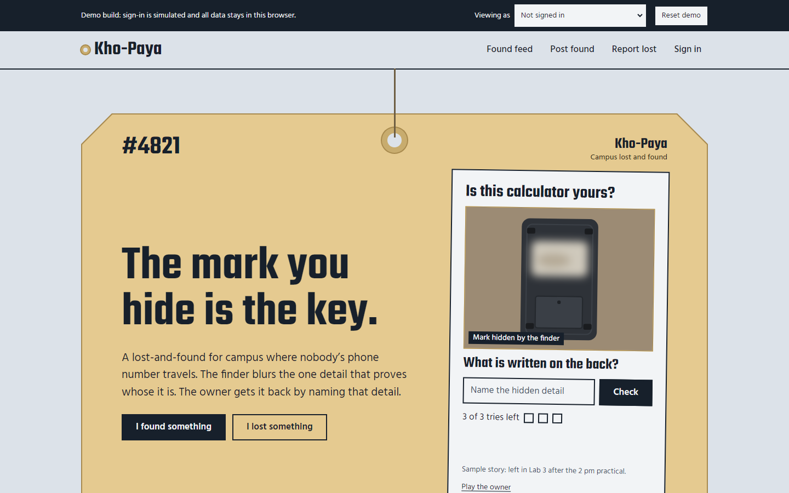
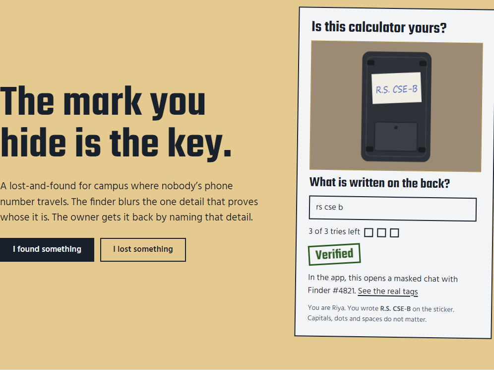
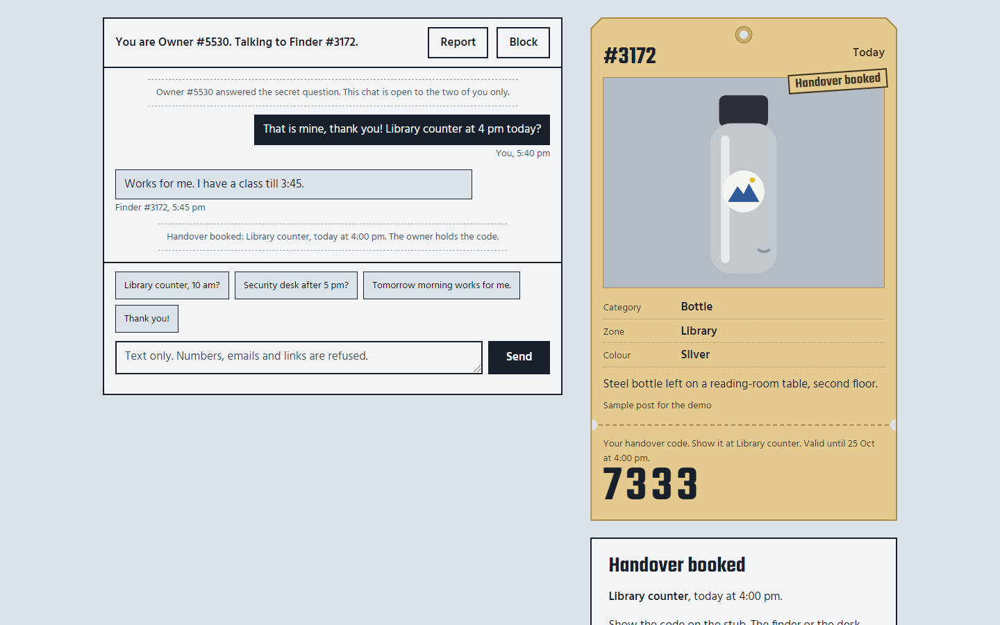
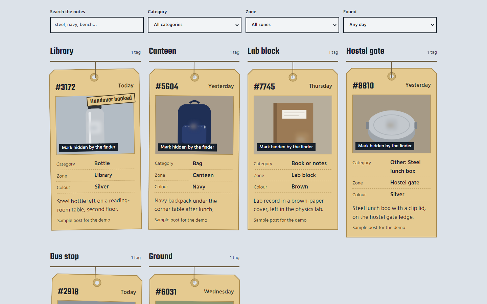
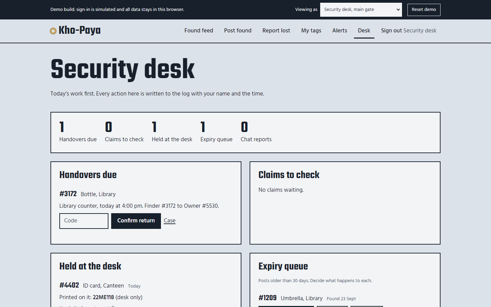
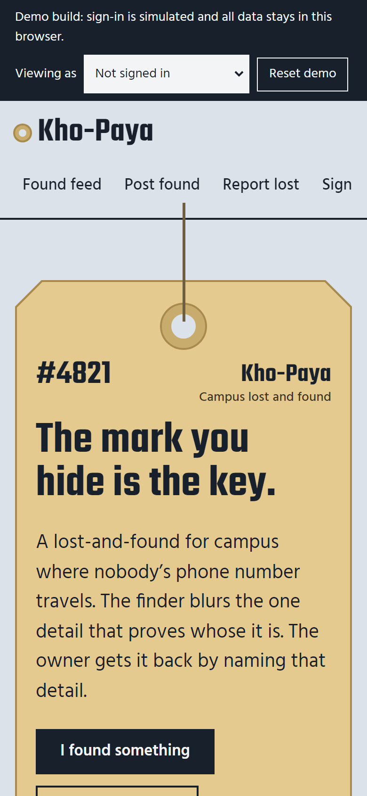
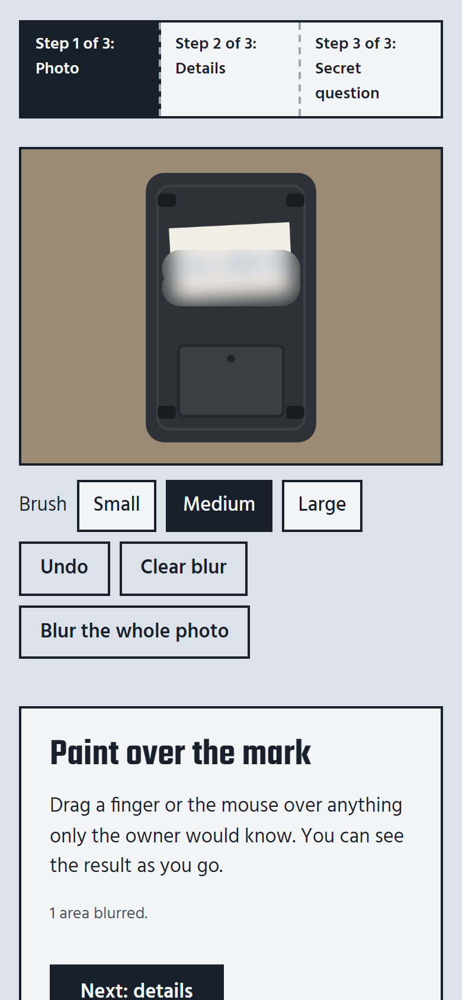

# Kho-Paya

**A campus lost-and-found where the detail the photo hides becomes the key that unlocks the item.**

Finders post what they found with the identifying mark blurred, and set one question about it. Owners prove the item is theirs by answering that question, talk to the finder through a masked chat, and close the case with a one-time 4-digit code at a safe spot on campus. Nobody's phone number, email or room number is ever shown to another student.

> **Live demo:** https://jatin-code16.github.io/Lost-Found/
> No sign-up needed: pick a demo account in the bar at the top of the page.



---

## Contents

- [Why](#why)
- [How it works](#how-it-works)
- [Features](#features)
- [Screenshots](#screenshots)
- [Quick start](#quick-start)
- [Demo walkthrough](#demo-walkthrough)
- [Privacy and security](#privacy-and-security)
- [Tech stack](#tech-stack)
- [Project structure](#project-structure)
- [Configuration](#configuration)
- [Quality checks](#quality-checks)
- [Deployment](#deployment)
- [Roadmap](#roadmap)
- [Status and known limits](#status-and-known-limits)
- [How this was made](#how-this-was-made)
- [Credits and license](#credits-and-license)

---

## Why

Today a lost item on campus gets posted in a WhatsApp group with a photo and the finder's phone number. That fails in three ways:

1. **Exposure.** The finder's number reaches hundreds of strangers.
2. **False claims.** The photo shows exactly what to describe, so anyone can claim the item.
3. **Noise.** The post is buried within hours.

Kho-Paya (Hindi for "lost-found") is built on three rules:

| Rule | What it means in the app |
|---|---|
| Contact never travels; messages do. | No contact fields. Chat runs on aliases like *Finder #4821* and *Owner #1170*. Phone numbers, emails, links, handles and room numbers are refused before they send. |
| Show enough to recognise, never enough to fake. | The public sees category, zone, day and a blurred photo. The telling detail is hidden, and its answer is stored only as a salted hash. |
| A handover is a verified event, not a meeting. | Handovers happen only at listed safe spots during open hours. The owner shows a code; the finder or the security desk types it in. |

## How it works

1. **Posted.** The finder photographs the item, paints a blur over the name, sticker or mark, and writes one question about it. It takes under a minute on a phone.
2. **Verified.** The owner answers. They get three tries a day, and a wrong answer only ever says *Not a match*. The right answer un-blurs the photo.
3. **Chat.** Finder and owner agree a safe spot through a masked, text-only chat.
4. **Returned.** At the spot, the owner's 4-digit code closes the case and writes it to the desk's register.

ID cards, wallets, phones and keys never reach the public feed. They go straight to the security desk, and only the student whose roll number matches gets a private alert.

## Features

**For finders**
- Three-step posting: photo, details, secret question
- Live camera, photo upload, or no photo at all
- Blur brush in three sizes, with undo and a keyboard-friendly "blur the whole photo"
- Photos compressed to under 300 KB on the device
- Default question for each category; *Other* asks "What did you find?"
- "No unique mark" option, which routes claims through the desk

**For owners**
- Feed grouped by campus zone, with search and filters
- Claim by answering the hidden-detail question: 3 tries a day, no hints
- Private lost reports that raise an alert when a matching tag goes up
- Masked chat with quick replies and a safe-spot picker
- The handover code shown on the tag's tear-off stub
- An optional thank-you note to the finder

**For the security desk**
- Dashboard with handovers due, claims to check, items held, the expiry queue and chat reports
- Walk-in intake for items handed in at the counter
- In-person check for sensitive items, with the roll number logged at collection
- Register of every claim, code and desk action
- 30-day expiry with a decision: keep, donate or dispose
- Moderation: uphold a report (strike) or dismiss it, and remove posts

**Safety rules**
- Contact-detail filter on chat, notes, item names and thank-you notes
- Report and Block on every chat
- Strikes for guessing across items; suspension after 3 strikes
- Second correct claimant queued; the finder can ask the desk to check a claim

## Screenshots

| The claim moment | Masked chat and the handover code |
|---|---|
|  |  |
| **Found feed, grouped by zone** | **Security desk dashboard** |
|  |  |

<p>
  
  &nbsp;
  
</p>

## Quick start

The app is static: there is no build step and nothing to install.

**Option 1: open the file.** Double-click `index.html`. Everything works, including the camera in Chrome and Edge. Offline mode needs a server.

**Option 2: run the local server** (Node.js 18 or later):

```bash
npm start
# open http://localhost:5173
```

All data lives in your browser's `localStorage`. **Reset demo** in the top bar restores the sample data.

## Demo walkthrough

Pick an account in the **Viewing as** menu at the top. Real names appear only in that menu; inside the app everyone is an alias.

| Demo account | Role in the story |
|---|---|
| Aman | Finds a calculator in Lab 3 |
| Riya | Owns it; her initials are on the back |
| A stranger | Tries to claim it |
| Kabir | Lost an umbrella on the college bus; his ID card is waiting at the desk |
| Ishaan | Has a handover booked today for his steel bottle |
| Security desk, main gate | Runs the desk dashboard |

**The 90-second demo**

1. **As Aman:** *I found something* → *Use the demo calculator photo* (or *Open the camera*) → paint over the sticker → zone *Lab block* → keep the default question → answer `R.S. CSE-B` → *Post the tag*.
2. **As the stranger:** open the new tag → *This is mine* → type anything. The stamp says *Not a match* and the photo stays blurred.
3. **As Riya:** same tag → type `rs cse-b`. The photo un-blurs and the chat opens.
4. **In the chat:** type a phone number and watch it get refused. Tap *Library counter, 10 am?*, propose the handover, use *see this case as Finder* to accept, then type the owner's code. The case closes.
5. **Optional:** as Ishaan, post a black umbrella at *Bus stop* with *No unique mark*. Kabir gets a match alert. As the desk, open *Desk*.

The landing page has a self-contained version of steps 2 and 3. Guess what is written on the calculator, or click *Play the owner*.

## Privacy and security

| Kept | Never collected |
|---|---|
| College email (to sign in; never shown to students; the desk can see it only during a dispute, and that view is logged) | Phone numbers |
| Alias, posts, private lost reports | Room numbers |
| Secret answers, as salted hashes only | Social media handles |
| Chat, deleted 30 days after the case closes | Location |
| Handover register (who, what, when, where) | Third-party trackers or analytics |

**In this demo build** everything runs in the browser. Answers and codes are hashed with salted SHA-256 through Web Crypto. A production pilot should move hashing, OTP email and photo storage to a server (see the [roadmap](docs/ROADMAP.md)).

## Tech stack

The app uses the plain web platform: **no framework, no build step and no npm dependencies.**

| Layer | Technology |
|---|---|
| Markup and styles | HTML5; CSS3 with custom-property design tokens, Grid and `clip-path`; phone first |
| Logic | Vanilla JavaScript (ES2020), hash router, delegated events |
| Storage | `localStorage` |
| Security | Web Crypto (`crypto.subtle` SHA-256, `getRandomValues`) |
| Photos | Canvas 2D (blur brush, JPEG compression), `getUserMedia` camera, Pointer Events |
| Offline and install | Service Worker, Cache API, Web App Manifest |
| Fonts | Teko and Hind, from Google Fonts |
| Local server | Node.js built-ins only (`server.mjs`) |
| Hosting | GitHub Pages through GitHub Actions (free) |

The full breakdown is in [docs/PROJECT-DETAILS.md](docs/PROJECT-DETAILS.md#9-tech-stack).

## Project structure

```text
.
├── index.html                 Page shell: demo bar, header, main, footer
├── assets/
│   ├── store.js               Data layer: rules, hashing, contact filter, matching, all actions
│   ├── app.js                 Views and router: landing, feed, post, claim, case, desk and more
│   ├── drawings.js            SVG drawings of sample items (hidden mark drawn only when allowed)
│   ├── app.css                Design tokens and styles
│   └── icon.svg               App icon
├── manifest.webmanifest       Installable app
├── sw.js                      Offline shell
├── server.mjs                 Zero-dependency local server
├── package.json               npm scripts (start, check, render)
├── .github/workflows/
│   └── deploy-pages.yml       Free deploy to GitHub Pages
├── docs/
│   ├── PROJECT-DETAILS.md     Full project documentation
│   ├── DEPLOYMENT.md          Free deployment guide and demo-day checklist
│   ├── ROADMAP.md             Future add-ons
│   ├── process-note-kho-paya.md   Who decided what: human and AI
│   └── screenshots/           Images used in this README
├── PRD Campus Lost & Found with Private Recovery.md   Product requirements
└── AGENTS.md, .agents/        The human-and-AI working method used to build this
```

## Configuration

Everything campus-specific is at the top of `assets/store.js`.

| Setting | Constant | Default (sample) |
|---|---|---|
| College email domain | `COLLEGE_DOMAIN` | `college.edu.in` |
| Campus zones | `ZONES` | Library, Canteen, Lab block, Hostel gate, Bus stop, Ground, Transport |
| Neighbouring zones for matching | `NEIGHBOURS` | Assumed; set to your campus map |
| Categories and default questions | `CATEGORIES` | 12 categories; ID card, wallet, phone and keys are sensitive |
| Safe spots and hours | `SPOTS` | Security desk, main gate (8 am to 8 pm); Library counter (9 am to 6 pm) |
| Tries per item per day | `ATTEMPTS_PER_DAY` | 3 |
| Found post lifetime | `POST_DAYS` | 30 days |
| Handover code validity | `CODE_VALID_H` | 24 hours |

After changing the seed data, click **Reset demo** in the browser to see it.

## Quality checks

| Command | What it does |
|---|---|
| `npm run check` | Source scan for default design patterns and accessibility gaps |
| `npm run render` | Renders the page at 1440, 768 and 390 px and checks overflow, headline length, fonts, contrast, focus and console errors. Needs `npm start` running and Playwright (`npm i -D playwright && npx playwright install chromium`). |

Last results: the source scan is tier Low with 0 failing checks, and the render check has 0 failures at all three widths. The full demo journey, the camera flow, the *Other* item flow and the landing demo were tested end to end in Chromium with no console errors. Not yet tested: a real phone with a real camera, and a screen reader.

## Deployment

The app is a set of static files, so it can be hosted for free on GitHub Pages, Netlify, Cloudflare Pages or Vercel. HTTPS, which every one of these provides, is needed for the camera and offline mode.

The quickest route is GitHub Pages:

1. Push this repository to GitHub as a **public** repository.
2. In the repository, open **Settings → Pages** and set **Source** to **GitHub Actions**.
3. Push to `main` or `master`. The included workflow publishes the app to `https://<your-username>.github.io/<repo-name>/`.

Step-by-step instructions, the alternatives and a demo-day checklist are in **[docs/DEPLOYMENT.md](docs/DEPLOYMENT.md)**.

## Roadmap

Planned add-ons, from turning the demo into a campus pilot to QR posters, push notifications and photo matching, are in **[docs/ROADMAP.md](docs/ROADMAP.md)**. Each one says how it can be done with free tools.

## Status and known limits

This is a **front-end demo build**, made to show the full journey in one browser.

- There is no server. All data stays in one browser, and the other side of a case is seen by switching accounts in the demo bar.
- Sign-in is simulated: the code is shown on screen instead of emailed.
- Because everything is in one browser, the original photo is stored locally even though the interface only shows it after verification.
- QR poster posting (PRD F15) is not built.
- Sample content to confirm or replace before a pilot:
  - the zones, safe spots, hours and email domain;
  - the eight sample posts and the demo people;
  - the landing-page story (the PRD's Lab 3 calculator).

## How this was made

Kho-Paya was built for a Human × AI creativity challenge. The human wrote the PRD (the problem, principles, decisions, scenarios and the lost-property-tag direction) and made the calls during the build: the landing direction, English only, the camera, and asking for a name when *Other* is chosen. An AI assistant (Claude) generated options and wrote the code. The split is recorded in [docs/process-note-kho-paya.md](docs/process-note-kho-paya.md).

## Credits and license

- Fonts: [Teko](https://fonts.google.com/specimen/Teko) and [Hind](https://fonts.google.com/specimen/Hind) by the Indian Type Foundry, under the SIL Open Font License.
- Item drawings were made in code for this project.

**License:** none chosen yet. Until a `LICENSE` file is added, the code is all rights reserved by the author. Add one (for example MIT) if you want others to reuse it.
