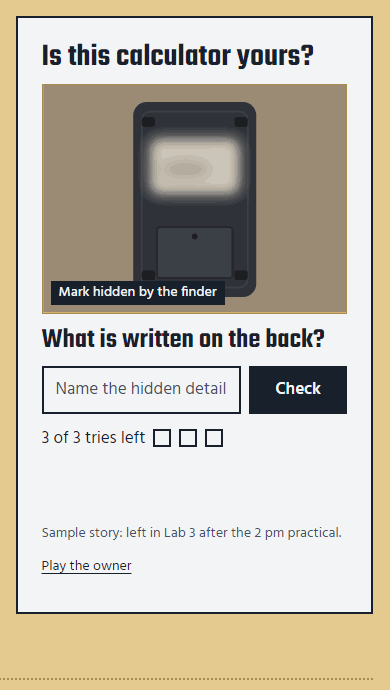
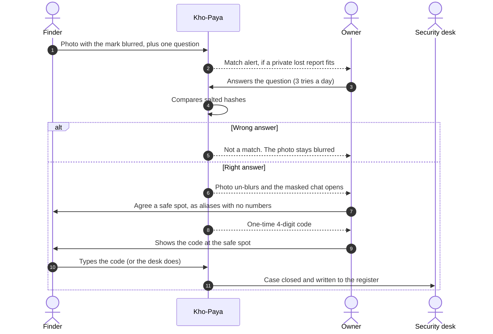
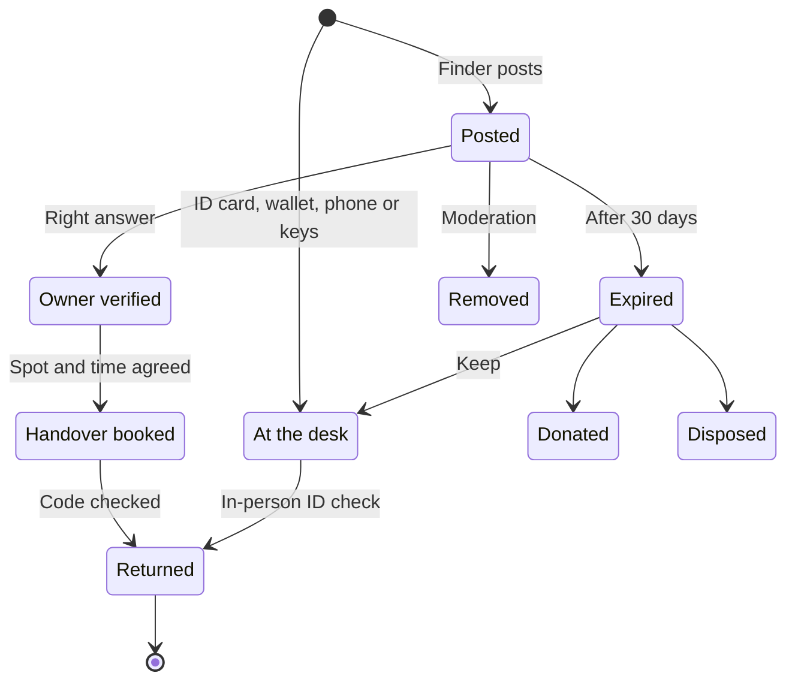

<div align="center">


# Kho-Paya

**A campus lost-and-found where the detail the photo hides becomes the key that unlocks the item.**

[](https://github.com/Jatin-code16/Lost-Found/actions/workflows/deploy-pages.yml)
[](https://jatin-code16.github.io/Lost-Found/)
[](package.json)
[](#tech-stack)
[](#tech-stack)

[**Open the live demo**](https://jatin-code16.github.io/Lost-Found/) | [Browse the found feed](https://jatin-code16.github.io/Lost-Found/#/feed) | [Project details](docs/PROJECT-DETAILS.md) | [Deploy your own](docs/DEPLOYMENT.md) | [Roadmap](docs/ROADMAP.md)

<br>



<sub>The claim moment, recorded from the live app: a wrong answer keeps the photo blurred, the right one reveals it.</sub>

</div>

---

Finders post what they found with the identifying mark blurred and set one question about it. Owners prove the item is theirs by answering that question, talk to the finder through a masked chat, and close the case with a one-time 4-digit code at a safe spot on campus.

**Nobody's phone number, email or room number is ever shown to another student.**

| | |
|---|---|
| **The problem** | Lost items get posted in WhatsApp groups with the finder's number and a photo that shows exactly what to describe |
| **The answer** | Hide the one detail that proves ownership, and make it the question the owner must answer |
| **Who it serves** | Owners, finders and the campus security desk |
| **How it is built** | Plain HTML, CSS and JavaScript: no framework, no build step, zero dependencies |
| **Cost to run** | Free: static hosting on GitHub Pages, with HTTPS |

## Contents

- [Try it in 30 seconds](#try-it-in-30-seconds)
- [Why](#why)
- [How it works](#how-it-works)
- [Features](#features)
- [Screenshots](#screenshots)
- [Quick start](#quick-start)
- [The 90-second demo](#the-90-second-demo)
- [Privacy and security](#privacy-and-security)
- [Tech stack](#tech-stack)
- [Project structure](#project-structure)
- [Configuration](#configuration)
- [Quality checks](#quality-checks)
- [Deployment](#deployment)
- [Roadmap](#roadmap)
- [FAQ](#faq)
- [Status and known limits](#status-and-known-limits)
- [Contributing](#contributing)
- [How this was made](#how-this-was-made)
- [Credits and license](#credits-and-license)

---

## Try it in 30 seconds

1. Open the **[live demo](https://jatin-code16.github.io/Lost-Found/)**. No sign-up is needed.
2. In **Is this calculator yours?** on the first screen, type any guess. The stamp says *Not a match* and the photo stays blurred.
3. Click **Play the owner**, type `R.S. CSE-B`, and watch the sticker un-blur.

For the full journey (posting, chatting and the handover code), follow [the 90-second demo](#the-90-second-demo).

## Why

Today a lost item on campus gets posted in a WhatsApp group with a photo and the finder's phone number. That fails in three ways:

1. **Exposure.** The finder's number reaches hundreds of strangers.
2. **False claims.** The photo shows exactly what to describe, so anyone can claim the item.
3. **Noise.** The post is buried within hours.

Kho-Paya (Hindi for "lost-found") is built on three rules:

| Rule | What it means in the app |
|---|---|
| **Contact never travels; messages do.** | No contact fields. Chat runs on aliases like *Finder #4821* and *Owner #1170*. Phone numbers, emails, links, handles and room numbers are refused before they send. |
| **Show enough to recognise, never enough to fake.** | The public sees category, zone, day and a blurred photo. The telling detail is hidden, and its answer is stored only as a salted hash. |
| **A handover is a verified event, not a meeting.** | Handovers happen only at listed safe spots during open hours. The owner shows a code; the finder or the security desk types it in. |

## How it works



1. **Posted.** The finder photographs the item, paints a blur over the name, sticker or mark, and writes one question about it. It takes under a minute on a phone.
2. **Verified.** The owner answers. They get three tries a day, and a wrong answer only ever says *Not a match*. The right answer un-blurs the photo.
3. **Chat.** Finder and owner agree a safe spot through a masked, text-only chat.
4. **Returned.** At the spot, the owner's 4-digit code closes the case and writes it to the desk's register.

ID cards, wallets, phones and keys never reach the public feed. They go straight to the security desk, and only the student whose roll number matches gets a private alert.

<details>
<summary><b>The life of a tag</b> (every status an item can have)</summary>

<br>



</details>

## Features

<table>
<tr>
<td valign="top" width="33%">

**For finders**
- Three-step posting: photo, details, secret question
- Live camera, photo upload, or no photo at all
- Blur brush in three sizes, with undo and a keyboard-friendly "blur the whole photo"
- Photos compressed to under 300 KB on the device
- Default question for each category; *Other* asks "What did you find?"
- "No unique mark" option, which routes claims through the desk

</td>
<td valign="top" width="33%">

**For owners**
- Feed grouped by campus zone, with search and filters
- Claim by answering the hidden-detail question: 3 tries a day, no hints
- Private lost reports that raise an alert when a matching tag goes up
- Masked chat with quick replies and a safe-spot picker
- The handover code shown on the tag's tear-off stub
- An optional thank-you note to the finder

</td>
<td valign="top" width="33%">

**For the security desk**
- Handovers due, claims to check, items held, the expiry queue and chat reports in one dashboard
- Walk-in intake for items handed in at the counter
- In-person check for sensitive items, with the roll number logged
- A register of every claim, code and desk action
- 30-day expiry: keep, donate or dispose
- Moderation: strikes, dismissals and post removal

</td>
</tr>
</table>

**Safety rules throughout:** a contact-detail filter on chat, notes, item names and thank-you notes; Report and Block on every chat; strikes for guessing across items, with suspension after 3; and a queue for a second correct claimant, plus a way for the finder to ask the desk to check a claim.

## Screenshots

| The claim moment | Masked chat and the handover code |
|---|---|
|  |  |
| **Found feed, grouped by zone** | **Security desk dashboard** |
|  |  |

<p align="center">
  
  &nbsp;&nbsp;
  
</p>

<details>
<summary><b>The landing page on desktop</b></summary>

<br>


</details>

## Quick start

The app is static: there is no build step and nothing to install.

```bash
git clone https://github.com/Jatin-code16/Lost-Found.git
cd Lost-Found
npm start          # Node.js 18+; serves http://localhost:5173
```

No Node.js? Just open `index.html` in Chrome, Edge or Firefox. Everything works, including the camera in Chromium browsers; only offline mode needs a server.

All data lives in your browser's `localStorage`. **Reset demo** in the top bar restores the sample data.

## The 90-second demo

Pick an account in the **Viewing as** menu at the top. Real names appear only in that menu; inside the app everyone is an alias.

| Demo account | Role in the story |
|---|---|
| Aman | Finds a calculator in Lab 3 |
| Riya | Owns it; her initials are on the back |
| A stranger | Tries to claim it |
| Kabir | Lost an umbrella on the college bus; his ID card is waiting at the desk |
| Ishaan | Has a handover booked today for his steel bottle |
| Security desk, main gate | Runs the desk dashboard |

1. **As Aman:** *I found something* → *Use the demo calculator photo* (or *Open the camera*) → paint over the sticker → zone *Lab block* → keep the default question → answer `R.S. CSE-B` → *Post the tag*.
2. **As the stranger:** open the new tag → *This is mine* → type anything. The stamp says *Not a match* and the photo stays blurred.
3. **As Riya:** same tag → type `rs cse-b`. The photo un-blurs and the chat opens.
4. **In the chat:** type a phone number and watch it get refused. Tap *Library counter, 10 am?*, propose the handover, use *see this case as Finder* to accept, then type the owner's code. The case closes.
5. **Optional:** as Ishaan, post a black umbrella at *Bus stop* with *No unique mark*. Kabir gets a match alert. As the desk, open *Desk*.

> [!TIP]
> Presenting this live? The [demo-day checklist](docs/DEPLOYMENT.md#7-demo-day-checklist) covers camera permission, offline backup and resetting the data before you start.

## Privacy and security

| Kept | Never collected |
|---|---|
| College email (to sign in; never shown to students; the desk can see it only during a dispute, and that view is logged) | Phone numbers |
| Alias, posts, private lost reports | Room numbers |
| Secret answers, as salted hashes only | Social media handles |
| Chat, deleted 30 days after the case closes | Location |
| Handover register (who, what, when, where) | Third-party trackers or analytics |

**How the secret stays secret**
- Answers are normalised, so `R.S. CSE-B`, `rs cse b` and `RSCSEB` are the same answer. Nothing else is ever "close".
- They are hashed with a per-item salt before they are stored, and only hashes are compared.
- The photos of sample items are drawn in code. The hidden mark is drawn only for someone allowed to see it; everyone else's page never contains it.

> [!NOTE]
> This is a front-end demo, so hashing uses salted SHA-256 through Web Crypto in the browser. A campus pilot should move hashing (bcrypt or argon2), OTP email and photo storage to a server. The [roadmap](docs/ROADMAP.md) shows how, with free tools.

## Tech stack

The app uses the plain web platform: **no framework, no build step and no npm dependencies.**

| Layer | Technology |
|---|---|
| Markup and styles | HTML5; CSS3 with custom-property design tokens, Grid and `clip-path`; phone first |
| Logic | Vanilla JavaScript (ES2020), hash router, delegated events |
| Storage | `localStorage` |
| Security | Web Crypto (`crypto.subtle` SHA-256, `getRandomValues`) |
| Photos | Canvas 2D (blur brush, JPEG compression), `getUserMedia` camera, Pointer Events |
| Offline and install | Service Worker, Cache API, Web App Manifest |
| Fonts | Teko and Hind, from Google Fonts |
| Local server | Node.js built-ins only (`server.mjs`) |
| Hosting and CI | GitHub Pages, deployed by GitHub Actions (free) |

The full breakdown is in [docs/PROJECT-DETAILS.md](docs/PROJECT-DETAILS.md#9-tech-stack).

## Project structure

<details>
<summary>Show the file tree</summary>

```text
.
├── index.html                 Page shell: demo bar, header, main, footer
├── assets/
│   ├── store.js               Data layer: rules, hashing, contact filter, matching, all actions
│   ├── app.js                 Views and router: landing, feed, post, claim, case, desk and more
│   ├── drawings.js            SVG drawings of sample items (hidden mark drawn only when allowed)
│   ├── app.css                Design tokens and styles
│   └── icon.svg               App icon
├── manifest.webmanifest       Installable app
├── sw.js                      Offline shell
├── server.mjs                 Zero-dependency local server
├── package.json               npm scripts (start, check, render)
├── .github/workflows/
│   └── deploy-pages.yml       Free deploy to GitHub Pages on every push
├── docs/
│   ├── PROJECT-DETAILS.md     Full project documentation
│   ├── DEPLOYMENT.md          Free deployment guide and demo-day checklist
│   ├── ROADMAP.md             Future add-ons
│   ├── process-note-kho-paya.md   Who decided what: human and AI
│   └── screenshots/           Images and the demo GIF used in this README
├── PRD Campus Lost & Found with Private Recovery.md   Product requirements
└── AGENTS.md, .agents/        The human-and-AI working method used to build this
```

</details>

| Where to look | For |
|---|---|
| [`assets/store.js`](assets/store.js) | Every rule: tries per day, matching, hashing, the contact filter, handovers, desk actions |
| [`assets/app.js`](assets/app.js) | Every screen and the router |
| [`assets/app.css`](assets/app.css) | The design tokens at the top, then the styles |

## Configuration

Everything campus-specific is at the top of [`assets/store.js`](assets/store.js).

<details>
<summary>Show the settings</summary>

<br>

| Setting | Constant | Default (sample) |
|---|---|---|
| College email domain | `COLLEGE_DOMAIN` | `college.edu.in` |
| Campus zones | `ZONES` | Library, Canteen, Lab block, Hostel gate, Bus stop, Ground, Transport |
| Neighbouring zones for matching | `NEIGHBOURS` | Assumed; set to your campus map |
| Categories and default questions | `CATEGORIES` | 12 categories; ID card, wallet, phone and keys are sensitive |
| Safe spots and hours | `SPOTS` | Security desk, main gate (8 am to 8 pm); Library counter (9 am to 6 pm) |
| Tries per item per day | `ATTEMPTS_PER_DAY` | 3 |
| Found post lifetime | `POST_DAYS` | 30 days |
| Chat kept after close | `CHAT_KEEP_DAYS` | 30 days |
| Handover code validity | `CODE_VALID_H` | 24 hours |
| Finder no-show flag | `NO_SHOW_H` | 48 hours |
| Strikes before suspension | `STRIKES_TO_SUSPEND` | 3 |

After changing the seed data, click **Reset demo** in the browser to see it.

</details>

## Quality checks

| Command | What it does |
|---|---|
| `npm run check` | Source scan for default design patterns and accessibility gaps |
| `npm run render` | Renders the page at 1440, 768 and 390 px and checks overflow, headline length, fonts, contrast, focus and console errors. Needs `npm start` running and Playwright (`npm i -D playwright && npx playwright install chromium`). |

Every push also runs a JavaScript syntax check in the [deploy workflow](.github/workflows/deploy-pages.yml) before publishing.

| Check | Last result |
|---|---|
| Source scan | Tier Low, 0 failing checks |
| Render check at 1440, 768 and 390 px | 0 failures |
| Full demo journey, camera flow, *Other* item flow, landing demo | Passed end to end in Chromium, no console errors |
| Keyboard | Logical tab order, visible focus |
| Not yet tested | A real phone with a real camera; a screen reader |

## Deployment

This repository deploys itself. Every push to `main` runs [the workflow](.github/workflows/deploy-pages.yml), which checks the JavaScript and publishes only the app files to **https://jatin-code16.github.io/Lost-Found/**. The PRD, the docs and the `.agents` kit stay in the repository but are not served on the website.

**To deploy your own copy for free:** fork the repository, keep it public, then open **Settings → Pages** and set **Source** to **GitHub Actions**. Your copy goes live at `https://<your-username>.github.io/Lost-Found/`.

Netlify, Cloudflare Pages and Vercel work too, also for free. All the steps, a post-deploy checklist and a demo-day checklist are in **[docs/DEPLOYMENT.md](docs/DEPLOYMENT.md)**.

## Roadmap

| Phase | Highlights |
|---|---|
| **1. Pilot essentials** | Shared database, real college-email OTP, server-side hashing, protected photo storage, real-time chat |
| **2. From the PRD's later list** | QR notice-board posters, printable desk tags, a second question for valuables, CSV export of the register |
| **3. Smarter and faster** | Push notifications for matches, offline posting queue, better matching for *Other* items, photo similarity, a success-metrics dashboard |
| **4. Polish and reach** | Screen-reader audit, real-device testing, PNG app icons, dark theme, college single sign-on |

Each add-on has its reason and a free way to build it in **[docs/ROADMAP.md](docs/ROADMAP.md)**.

## FAQ

<details>
<summary><b>Why not just hide the whole photo?</b></summary>

<br>

Owners need to recognise their item from the feed, so the category, zone, day and most of the photo stay visible. Only the one detail that proves ownership is hidden.
</details>

<details>
<summary><b>What stops someone from guessing the answer?</b></summary>

<br>

Three tries per item per day, and no hints: a wrong answer never says "close". Failing on three different items in one day adds a strike, and three strikes suspend the account. The finder can also ask the desk to check a claim.
</details>

<details>
<summary><b>What if the item has no unique mark, or the owner forgot it?</b></summary>

<br>

The finder ticks *It has no unique mark*, and claims then go to the security desk, which asks the owner when and where they lost it. An owner who forgot the detail can choose *Verify at the desk instead* and bring their college ID.
</details>

<details>
<summary><b>Why can't my friend see the item I just posted on their phone?</b></summary>

<br>

This is a demo build: each browser keeps its own data. To see both sides of a case on one device, switch accounts with **Viewing as** in the top bar. A shared backend is the first item on the [roadmap](docs/ROADMAP.md).
</details>

<details>
<summary><b>Is anything sent to a server?</b></summary>

<br>

No. Apart from loading the page and its fonts, everything stays in your browser. There are no trackers or analytics.
</details>

<details>
<summary><b>Does it work offline?</b></summary>

<br>

Yes, once you have visited the HTTPS site (or `npm start`) once. The service worker keeps the app shell, and your data is already on the device.
</details>

## Status and known limits

This is a **front-end demo build**, made to show the full journey in one browser.

- There is no server: all data stays in one browser, and the other side of a case is seen by switching accounts in the demo bar.
- Sign-in is simulated: the code is shown on screen instead of emailed.
- Because everything is in one browser, the original photo is stored locally even though the interface only shows it after verification.
- QR poster posting (PRD F15) is not built.
- Sample content to confirm or replace before a pilot:
  - the zones, safe spots, hours and email domain;
  - the eight sample posts and the demo people;
  - the landing-page story (the PRD's Lab 3 calculator).

## Contributing

Ideas and fixes are welcome.

1. Fork the repository and create a branch.
2. Run `npm start` and check your change at phone width (390 px) as well as desktop.
3. Run `npm run check` and keep the result at tier Low with 0 failing checks.
4. Open a pull request that says what changed and why.

Good first contributions are listed in [docs/ROADMAP.md](docs/ROADMAP.md): for example PNG app icons, a dark theme or the CSV export.

## How this was made

Kho-Paya was built for a Human × AI creativity challenge. The human wrote the PRD (the problem, principles, decisions, scenarios and the lost-property-tag direction) and made the calls during the build: the landing direction, English only, the camera, and asking for a name when *Other* is chosen. An AI assistant (Claude) generated options and wrote the code. The split is recorded in [docs/process-note-kho-paya.md](docs/process-note-kho-paya.md).

## Credits and license

- Fonts: [Teko](https://fonts.google.com/specimen/Teko) and [Hind](https://fonts.google.com/specimen/Hind) by the Indian Type Foundry, under the SIL Open Font License.
- Item drawings were made in code for this project.
- Badges by [Shields.io](https://shields.io).
